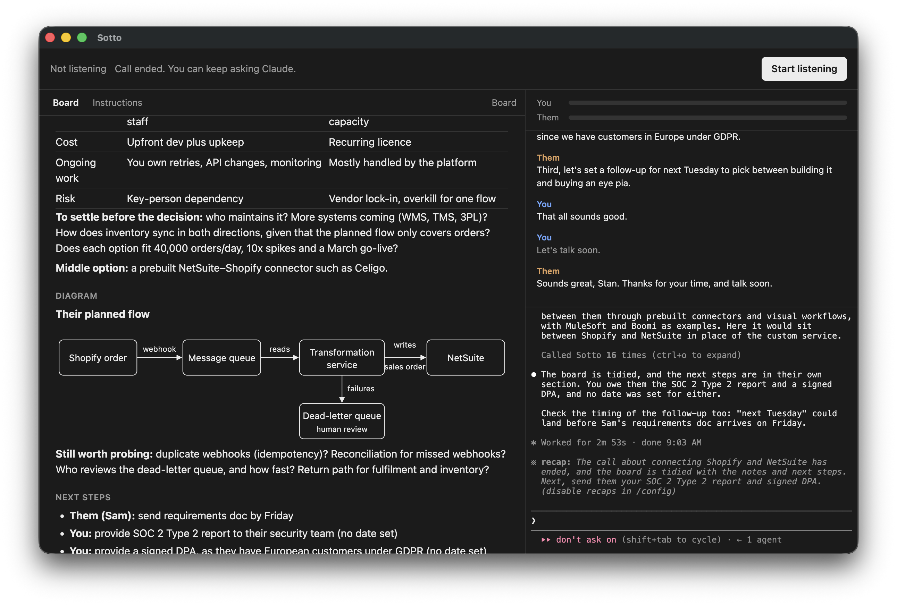

# Sotto

A silent companion for your calls. Sotto listens to your microphone and your computer's audio, and a local Claude keeps a private board while you talk: notes, definitions, links, diagrams and next steps. It never speaks, it doesn't join the call, and only you can see it.



Sotto is a spinoff of [Vibeconferencing](https://github.com/wanderingstan/vibeconf-app), which brings AI agents into video calls as participants who can hear, speak and share their screen. Sotto keeps the listening and the Claude loop, reusing its on-device transcription and agent techniques, but drops the bot: nobody else on the call knows it's there.

> **Status: proof of concept.** It has been tested on one Apple silicon Mac, on Google Meet calls with a headset. The Intel Mac and Windows packages haven't been run yet.

## What it does

- **Hears both sides:** your mic is labelled `You`, and everything your computer plays is labelled `Them`. Speech is transcribed on your machine with [Whistle](https://huggingface.co/Cactus-Compute/whistle).
- **Keeps a board:** Claude adds notes, defines terms, links companies and products, and draws diagrams as people describe things. New content is highlighted, and you can flip back through earlier boards.
- **Shows pictures and websites:** images appear on the board, and web pages open in a tab beside it. Links open in your own browser.
- **Answers you privately:** type to Claude in the terminal pane during the call.
- **Takes your instructions:** edit what Claude does in the Instructions tab, or in the `instructions.md` file (on a Mac, at `~/Library/Application Support/Sotto/`).

## Running it

You need a headset and [Claude Code](https://code.claude.com/docs/en/quickstart) installed and signed in. On a Mac, you also need macOS 14.2 or later.

Download Sotto for Mac or Windows from the [releases page](https://github.com/wanderingstan/sotto/releases). The Windows installer isn't signed, so SmartScreen will warn you: choose "More info", then "Run anyway". On Windows, Claude Code has to come from its native installer rather than npm.

To run from source instead, you also need Node.js:

```bash
git clone https://github.com/wanderingstan/sotto.git
cd sotto
npm install
npm start
```

Press **Start listening**. On a Mac, you'll be asked for microphone and system audio access the first time; Screen Recording isn't needed. The speech model (about 18 MB) downloads on first launch.

A headset is required. On speakers, your mic picks up the other side and the transcript gets muddled.

## Privacy and security

Be aware of these before using it on a real call:

- **Words leave your machine.** Transcription is local, but the transcript goes to Anthropic while the call runs, because that's where Claude's model runs.
- **Words are kept on disk.** Sotto's own log holds only timings and errors, but Claude Code keeps a session log under `~/.claude/projects` that contains the transcript.
- **Getting consent is up to you.** Laws on recording and transcribing calls vary by place.
- **Callers can try to instruct Claude.** Whatever is said on the call reaches it. So Claude runs with only the board tools and web search, without your files, shell, MCP servers, hooks or memory, and the board can't run scripts or load anything from the network. It's still possible for a hostile caller to talk Claude into putting call details in a web address it loads or links to.

## More

See the [roadmap](ROADMAP.md) for what's planned and what's still open. Run the tests with `npm test`.

## License

[MIT](LICENSE). Whistle's speech model is downloaded separately, under its own license.
